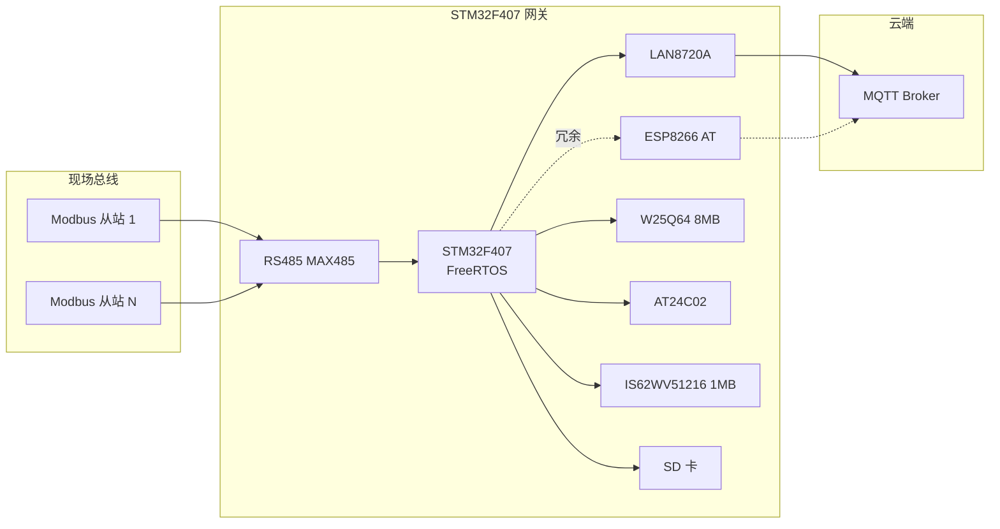

# STM32F407 FreeRTOS 工业物联网边缘网关

> 基于野火 STM32F407 + FreeRTOS 的工业 IoT 边缘网关原型 —— 把 RS485 现场总线数据可靠地经 MQTT 上行，并在**断网、任务卡死、远程升级**三类工业现场高频故障下做到*不丢数据、不砖机、有据可查*。


---

## 📖 项目简介

这是一个**单块开发板即可复现**的工业物联网边缘网关原型。主控为 STM32F407，调度核心为 FreeRTOS，向下通过 **RS485 / Modbus RTU** 轮询现场设备，向上通过 **LAN8720A 以太网 + MQTT** 把数据推送到 Broker，同时以 **ESP8266 (AT)** 作为冗余链路与配网通道。

本项目不是"FreeRTOS API 练习集"，而是围绕工业现场三个最朴素的问题给出工程答案：

| 现场问题 | 本项目答案 | 可验证产出 |
|---|---|---|
| **网断了数据怎么办？** | SD 卡 / SRAM 环形缓冲 + 幂等补传 | 断网 N 分钟数据零丢失、补传不重复 |
| **任务卡死了怎么办？** | IWDG + 软件心跳监控 + 受控重启 + 故障码落 EEPROM | 故障码可回溯到具体任务 |
| **要升级怎么办？** | W25Q64 双分区 OTA + Bootloader 切换 | MQTT 下发固件、重启后自愈 |

所有关键指标（端到端延迟、补传成功率、重启原因）均**实测可复现**，而非"理论上".

---

## 🎯 为什么做这个项目

2026-12-01 前交付一个"能拿出去讲、能被追问"的原型。真正的产出不是会用 RTOS API，而是一套**系统稳定性与实时性的落地证据**：

- 实测的"Modbus 采集 → MQTT 发布"端到端最坏延迟数字，以及构成该数字的每一段开销
- 断线补传的幂等去重逻辑
- 任务心跳与受控重启的完整故障闭环
- 双分区 OTA 升级链路
- 能讲清三个"为什么"（见文末[设计问答](#-设计问答三个为什么)）

这是求职时区分"做过"与"调过库"的部分。

---

## ✨ 核心特性

- 🧵 **多任务骨架**：以太网(MQTT)/Wi-Fi(ESP8266 AT)/RS485(Modbus RTU)/本地管理 四类任务同调度器运行，**优先级分级且有据可依**
- 📦 **断网缓存与补传**：断网期间数据落 SD 卡或外扩 SRAM(1MB) 环形缓冲，恢复后按序补传，**幂等去重**
- 🐕 **看门狗与异常恢复**：独立硬件看门狗 + FreeRTOS 软件定时器心跳监控；任务超时触发**受控重启**，故障码写 AT24C02
- 🔄 **OTA 升级通道**：W25Q64(8MB) 双分区升级，MQTT 分片接收 → 写 Flash → CRC 校验 → 重启由 Bootloader 完成切换
- ⏱️ **可复现的实时性**：给出端到端最坏延迟实测值（目标 < 200 ms，待实测）及开销分解
- 🧠 **设计可解释**：队列 vs 全局变量、事件组 vs 轮询、互斥量优先级继承三个关键决策有代码与文档双重支撑

---

## 🏗️ 系统架构

### 硬件拓扑



### 任务模型（FreeRTOS）

| 任务 | 职责 | 优先级(示意) | 理由 |
|---|---|---|---|
| `task_mqtt` | 以太网 MQTT 上行/下行 | 高 | 断网恢复后需快速排空缓存，链路时延敏感 |
| `task_modbus` | RS485 Modbus RTU 轮询 | 中高 | 采集节拍由现场设备决定，需稳定轮询周期 |
| `task_wifi` | ESP8266 AT 冗余/配网 | 中 | 主链路失效时切换，非实时 |
| `task_monitor` | 心跳/看门狗/故障诊断 | 中 | 软定时器周期性检查，保证系统可见性 |
| `task_local` | SD 卡/USB Host 本地管理 | 低 | 后台落盘/日志，可被抢占 |

> 任务间通过 **队列** 传递采集数据与命令，网络状态通过 **事件组** 广播，共享资源访问使用 **互斥量（优先级继承）**。

---

## 🔧 硬件资源

基于 STM32F407 开发板（含 LAN8720A / ESP8266 / RS485 收发器 / W25Q64 / AT24C02 / SD 卡，可选外扩 SRAM）。

| 类别 | 主要内容 |
|---|---|
| **基础规格** | 尺寸、PCB、RTC、螺母柱 |
| **电源系统** | 电源输入 / 输出、DC_IN 接口 |
| **USB 接口** | USB 转串口(CH340)、USB Device、USB Host |
| **调试接口** | JTAG、SWD（支持 DAP / JLINK / STLINK 等） |
| **存储** | SPI Flash W25Q64(8MB)、EEPROM、SD 卡、外扩 SRAM(1MB) |
| **人机交互** | RGB LED、按键、电容按键、蜂鸣器、电位器 |
| **显示与摄像头** | 液晶(FSMC 并口)、摄像头(DCMI) |
| **无线通信** | 蓝牙、NRF24L01、ESP8266 WIFI、LAN8720A 以太网 |
| **工业总线** | CAN(TJA1042)、RS485(MAX485)、RS232(MAX3232)、EBF 扩展 |
| **音频 & 传感器** | WM8978 音频、咪头 / 喇叭、AP3216C、MPU6050、红外等 |

### 本项目实际用到的外设

| 外设 | 用途 | 接口 |
|---|---|---|
| LAN8720A | 主上行链路（MQTT over TCP/IP） | RMII + LwIP |
| ESP8266 | 冗余链路 / 配网（AT 固件） | USART + AT |
| MAX485 | Modbus RTU 现场总线 | USART + DE/RE |
| W25Q64 (8MB) | 双分区 OTA 固件存储 | SPI |
| AT24C02 | 故障码 / 关键配置持久化 | I2C |
| SD 卡 | 断网数据缓存 / 本地日志 | SDIO/SPI |
| IS62WV51216 (1MB, 可选) | 高速环形缓冲区 | FSMC/SRAM |
| IWDG | 独立硬件看门狗 | 片内 |
| RGB LED / 蜂鸣器 | 状态指示 | GPIO |

---

## 📐 关键技术设计

### 1. 断网缓存与幂等补传

```
采集 → 队列 → 上行任务 → [链路可用?]
                              ├─ 是 → MQTT publish(seq) → 收到 ACK → 出队
                              └─ 否 → 写入环形缓冲(SD/SRAM)
断网恢复 → 从缓冲按 seq 顺序补传 → 云端按 seq 去重 → ACK 后出队
```

- **环形缓冲**：固定容量 + 覆盖策略，满时按策略丢弃最旧或拒绝写入（可配置）
- **幂等**：每条记录携带全局单调递增 `seq`，Broker 侧订阅端按 `seq` 去重，保证"至少一次"投递语义下的"恰好一次"效果
- **持久化**：重启后从 SD 卡恢复未确认队列，避免掉电丢数据

### 2. 看门狗与异常恢复

- **硬件层**：IWDG 由 `task_monitor` 统一喂狗，喂狗条件 = 所有关键任务心跳均正常
- **软件层**：各关键任务在循环中更新心跳时间戳；`task_monitor` 用 FreeRTOS 软件定时器周期检查
- **受控重启**：任一任务超时 → 记录故障码（任务 ID + 时间 + 原因）到 AT24C02 → 触发 `NVIC_SystemReset()`
- **可追溯**：上电后读取故障码，通过 MQTT 上报 / 串口打印，实现"有据可查"

### 3. OTA 双分区升级

```
MQTT 下发固件分片 → task_mqtt 写入 W25Q64(暂存区)
  → 全部接收完成 → CRC32 校验 → 写升级标志/元数据到 Flash 尾区
  → 受控重启 → Bootloader 检查标志 → 校验通过 → 拷贝到运行区 → 跳转
  → 失败则回滚至旧固件
```

- **A/B 双分区**：运行区与暂存区隔离，升级失败不影响现有固件
- **完整性**：分片带序号 + 整体 CRC32 + 版本号
- **回滚**：新固件首启动打标记，若多次启动失败自动回滚

### 4. 端到端实时性

目标：**"Modbus 采集 → MQTT 发布"最坏延迟 < 200 ms**（待实测，见[实测数据](#-实测数据)）。

延迟构成（可逐段测量）：
1. Modbus 请求发出 → 从站响应（总线时延 + 从站处理）
2. 响应 → 队列投递（RTOS 调度开销）
3. 队列 → 组包 → LwIP 协议栈处理
4. TCP 发送 → 网络传输
5. Broker 收到（抓包 / 订阅端时间戳）

---

## 🚀 快速开始

### 开发环境

| 工具 | 版本 / 说明 |
|---|---|
| 编译器 | `arm-none-eabi-gcc` 或 Keil MDK / STM32CubeIDE |
| RTOS | FreeRTOS（建议 v10.4+ / v11） |
| 协议栈 | LwIP（配合 LAN8720A）、可选用现成 MQTT client |
| 调试器 | ST-Link / J-Link / DAP-Link（SWD） |
| 构建 | Makefile / CMake（见 `build/`） |

### 编译与烧录

```bash
# 克隆
git clone https://github.com/<your-name>/stm32f407-iiot-gateway.git
cd stm32f407-iiot-gateway

# 配置网络参数
cp config/gateway.conf.example config/gateway.conf
# 编辑 gateway.conf：MQTT Broker 地址、端口、RS485 波特率、Modbus 从站地址等

# 编译
make -j8

# 烧录（SWD）
make flash        # 依赖 openocd / st-flash
```

### 最小验证路径

1. 串口连接，确认启动日志与任务创建成功
2. 接入一个 Modbus RTU 从站，观察 RS485 轮询
3. 启动本地 MQTT Broker（如 Mosquitto），订阅 `gateway/#`
4. 拔掉网线 → 观察数据落盘 → 插回网线 → 观察补传且无重复
5. 模拟任务卡死 → 观察 IWDG 触发重启 → 上电后读到故障码
6. 通过 MQTT 下发固件 → 观察 OTA 升级与重启切换

---

## 📊 实测数据

> 待填：以下为交付前必须补齐的**系统稳定性与实时性证据**。

| 指标 | 目标 | 实测值 | 说明 |
|---|---|---|---|
| 端到端最坏延迟（Modbus→MQTT） | < 200 ms | _TBD_ | 见[实时性分解](#4-端到端实时性) |
| 平均延迟 | — | _TBD_ | N 次采样均值 |
| 断网补传成功率 | 100% | _TBD_ | 拔网线 M 分钟场景 |
| 补传重复率 | 0 | _TBD_ | 幂等去重验证 |
| 任务卡死恢复时间 | < 3 s | _TBD_ | IWDG 超时周期 |
| OTA 升级成功率 | 100% | _TBD_ | 多次升级验证 |
| 长时间运行 | ≥ 72 h | _TBD_ | 稳定性 soak test |

---

## 🗺️ 路线图

> 时间窗口：2026-10-20 起，42 天 / 6 周，单人开发

- [ ] **Week 1**：FreeRTOS 补课 + 多任务骨架、队列/事件组/互斥量落地
- [ ] **Week 2**：LwIP + LAN8720A 以太网通、MQTT 上行链路
- [ ] **Week 3**：RS485 Modbus RTU 轮询任务、采集数据入队
- [ ] **Week 4**：断网缓存 + 幂等补传（SD/SRAM 环形缓冲）
- [ ] **Week 5**：IWDG + 心跳监控 + 受控重启 + 故障码；端到端延迟实测
- [ ] **Week 6**：W25Q64 双分区 OTA + Bootloader；soak test、文档与演示
- [ ] **2026-12-01**：交付原型 + 实测报告

---

## 📁 目录结构

```
.
├── app/                 # 应用层任务：mqtt / modbus / wifi / monitor / local
├── bsp/                 # 板级驱动：lan8720a, esp8266, max485, w25q64, at24c02, sd
├── bootloader/          # 双分区 OTA Bootloader
├── middleware/
│   ├── freertos/        # RTOS 内核与配置
│   ├── lwip/            # TCP/IP 协议栈
│   └── mqtt/            # MQTT client
├── drivers/             # STM32 HAL / LL
├── config/              # gateway.conf、FreeRTOSConfig.h
├── docs/                # 架构图、实测报告、故障码表
├── test/                # 测试脚本 / 演示场景
├── build/               # 构建产物
└── README.md
```

---

## ❓ 设计问答（三个为什么）

这三个问题会在面试 / 评审中被追问，答案写在代码与文档中：

### Q1：为什么用队列而不是全局变量？

- **解耦**：生产者（Modbus 轮询）与消费者（MQTT 上行）生命周期与速率解耦
- **同步**：队列自带阻塞/唤醒语义，天然实现"有数据才处理"，避免轮询空转
- **安全**：队列内部已加锁，避免共享全局变量带来的竞态与内存序问题
- **可观测**：队列水位可作为系统负载指标上报

### Q2：为什么用事件组处理网络状态？

- 网络状态（链路 up/down、DHCP 就绪、Broker 连接）是**多任务共同关心**的广播事件
- 事件组支持**位标志 + 多任务等待 + 逻辑组合**（如"链路 up 且 Broker 已连"才能发送）
- 相比信号量/轮询，避免多任务分别轮询状态变量，降低 CPU 与复杂度

### Q3：为什么互斥量的优先级继承能防止优先级反转？

- 场景：低优先级任务持锁 → 中优先级任务抢占 → 高优先级任务等锁被无限期阻塞
- 优先级继承：持锁的低优先级任务临时提升到等待者（高优先级）的优先级，尽快释放锁
- 效果：将"无界阻塞"压缩为"有限阻塞"，保证高优先级任务的响应时间可界定

---

## 🤝 贡献

本项目为个人学习与原型交付项目，欢迎 Issue / PR 交流。贡献前请阅读 `docs/CONTRIBUTING.md`（待补）。

## 📄 许可证

本项目采用 [MIT License](LICENSE)。

## 🙏 致谢

- FreeRTOS 社区与官方文档
- STM32 HAL / LwIP 生态
- 开发板厂商提供的 BSP 与例程

---

> **范围说明**：不做云端平台开发（仅 MQTT 上行 + 最小订阅端验证）、不做网关 GUI、不做多核/多 MCU 协同与 Linux 方案、不涵盖通用 RTOS 内核实现剖析。
